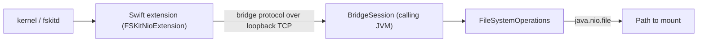

# fskit-nio-adapter

Provides directory contents specified by a `java.nio.file.Path` as an [FSKit](https://developer.apple.com/documentation/fskit) volume on macOS 27 and later, without third-party kernel or FUSE software.

The adapter registers as an `org.cryptomator.integrations.mount.MountService` named `FSKit (Experimental)`. It is an opt-in provider for early testers.

## Architecture

FSKit runs a file system as a sandboxed app extension launched by `fskitd`, while `MountService.forFileSystem(Path)` hands over a live `Path` in the caller's JVM. So the JVM that calls `mount()` serves the file system, and a thin Swift extension forwards FSKit operations to it over an authenticated loopback TCP connection:



- `mount()` starts a session on an ephemeral loopback port, and writes the port and a random token into a manifest in an owner-only directory under the temp directory. With a mount point set, it runs `/sbin/mount -F -t cryptomatorfs <that directory> <mountpoint>`. Without one, it asks FSKit through `libFSKitNioSupport.dylib` to mount that directory (`FSClient.mountSingleVolume`), and the system creates the mount point in `/Volumes`.
- `fskitd` names a mount point in `/Volumes` after the volume, appends ` 1` to a name that is taken, and refuses a name that is not ASCII. So the extension starts the volume under its name transliterated to ASCII, and gives it its real name once it is mounted.
- The extension reads the manifest, connects and presents the token. From then on it forwards the operations it supports and refuses every caller but root and the user who mounted.
- The extension answers what needs no round trip itself: extended attributes, lookups of hidden names, a sync with nothing written since the last one, the open of a file it created, and the continuation of a listing page. Apart from what these answers need, it holds only a map from node ids to FSKit items with the number of lookups of each, the volume's size, and the newest free space it has seen. While requests overlap, it also keeps the newest attributes of their items. For each file and directory it handed out other than the root, it keeps the attributes of the version FSKit may have cached, so that it can make FSKit drop that cache once the item changed outside the volume.
- The table of nodes and their paths, name handling, directory listings and open channels live in Java (`org.cryptomator.frontend.fskit.fs`).
- Each volume serves its requests concurrently. Requests on the same entries wait for each other where they would conflict, as a rename waits for the requests in flight below what it moves. Separate mounts are independent.
- The wire format is specified in [`protocol/PROTOCOL.md`](protocol/PROTOCOL.md).

This repository ships the Maven artifact `org.cryptomator:fskit-nio-adapter` with the built extension next to it (see "Embed the extension in an app"), the extension sources in `fskit/`, and a stand-in host app for local testing. The mount only works while an app containing the extension is installed and the extension is enabled.

## Build and test

Java (JDK 25, on macOS or Linux):

```
./mvnw verify
```

The build fails on a compiler warning. On macOS it also runs `swift build` (macOS 27 SDK). It puts `libFSKitNioSupport.dylib`, through which the provider checks the app, mounts without a mount point and learns of changes made outside a volume, into the jar and zips the extension into `target/fskit-nio-adapter-<version>-appex.zip`. `-P'!fskit-native'` leaves both out and needs no Swift tooling, as on Linux.

Swift (macOS 27 SDK, Swift 6.2 or later):

```
cd fskit
swift test                  # codec tests against protocol/vectors, and client tests
scripts/interop-test.sh     # Swift client against the Java server, nothing is mounted
scripts/process.sh          # SwiftFormat and SwiftLint, both have to be installed
```

The Swift sources follow [SwiftFormat](https://github.com/nicklockwood/SwiftFormat) and [SwiftLint](https://github.com/realm/SwiftLint), configured in `fskit/.swiftformat` and `fskit/.swiftlint.yml`.

To format and check what a commit contains, create `.git/hooks/pre-commit` with this content and make it executable:

```sh
#!/bin/sh
./fskit/scripts/process.sh --staged
```

When the hook reformats a staged file, it stops the commit so that the result can be reviewed. Commit again to go on.

## Install the extension

```
cd fskit
cp <profile for the extension's bundle identifier> Bundle/FSKitNioExtension.provisionprofile  # once, gitignored
CODESIGN_IDENTITY="Apple Development: …" scripts/package.sh

ditto build/FSKitNioHost.app /Applications/FSKitNioHost.app
codesign --verify --deep --strict /Applications/FSKitNioHost.app  # must pass
open /Applications/FSKitNioHost.app
```

Then enable "Cryptomator FSKit File System Extension (Dev)" in System Settings > General > Login Items & Extensions > File System Extensions (in the "By Category" view). `pluginkit -m -i org.cryptomator.fskit.host.extension` lists the extension once it is registered. macOS switches the extension off again when a reinstalled build has a changed `Info.plist`. A new bundle version alone, which the build takes from `pom.xml`, keeps it on.

For a file system type that no extension provides, `mount` exits with status 69 and `mount: Unable to invoke task`. With the extension disabled, it additionally prints `Module <bundle identifier> is disabled!`.

`package.sh` reads these environment variables:

| Variable | Default | Meaning |
| --- | --- | --- |
| `CODESIGN_IDENTITY` | `-` (ad-hoc) | Signing identity |
| `PROVISIONING_PROFILE` | `fskit/Bundle/FSKitNioExtension.provisionprofile` if present | Profile to embed into the extension |
| `HOST_BUNDLE_ID` | `org.cryptomator.fskit.host` | Bundle identifier of the host app. The extension's is this plus `.extension`. |
| `FS_TYPE_NAME` | `cryptomatordev`, from the property `fskit.test.fsType` of `pom.xml` | File system type name, as passed to `mount -t` |
| `SKIP_SWIFT` | unset | Set to `1` to skip `swift build` |

The published extension declares `cryptomatorfs`, the provider's default. The test host's extension declares a type of its own, so that an app that embeds the published extension, such as Cryptomator, cannot serve the test host's mounts. Its display name ends in "(Dev)", which tells the two extensions apart in System Settings.

The smoke test mounts with the type the installed test host declares, the mirroring test with `fskit.test.fsType`. For a build with another `FS_TYPE_NAME`, pass `-Dfskit.test.fsType=<name>` to the mirroring test. Any other JVM needs `-Dorg.cryptomator.frontend.fskit.fsType=<name>`.

### Signing

The extension carries the restricted `com.apple.developer.fskit.fsmodule` entitlement, which must be backed by a provisioning profile that authorizes it for the extension's bundle identifier. ExtensionKit refuses to launch an unprovisioned extension, so an ad-hoc build compiles and registers but cannot mount. Any Apple-issued identity works, including a free "Apple Development" certificate. Hardened runtime and notarization are not needed for local development.

A broken seal fails opaquely: `fskitd` does not launch a bundle whose signature is invalid, and the only symptom is `mount: Unable to invoke task`. After replacing the installed app, always check it with `codesign --verify --deep --strict`.

## Embed the extension in an app

An app that offers the provider embeds the extension. Next to the jar `org.cryptomator:fskit-nio-adapter`, each release publishes the extension as a zip with the classifier `appex` (`fskit-nio-adapter-<version>-appex.zip`). The extension works only with the jar of the same version, since the protocol between them can change with any version before 1.0.0. The jar holds `libFSKitNioSupport.dylib`. Both are built for Apple silicon and carry no signature but the linker's ad-hoc one.

The app:

1. Expands the zip.
2. Places `FSKitNioExtension.appex` in its `Contents/Extensions`, with a `CFBundleIdentifier` that starts with its own and a dot. The extension's `FSShortName` must be the type the JVM mounts with. The zip declares `cryptomatorfs`, the default, and an app that sets `-Dorg.cryptomator.frontend.fskit.fsType` changes it to match. Of two enabled extensions that declare the same type, either can serve the other app's mounts, so a second build of an app, such as a beta, declares a type of its own.
3. Embeds a provisioning profile for the extension's identifier that authorizes `com.apple.developer.fskit.fsmodule`, as `Contents/embedded.provisionprofile` of the extension.
4. Signs the dylib in the jar, as notarization requires.
5. Signs the extension with `fskit/Bundle/FSKitNioExtension.entitlements` plus `com.apple.application-identifier` and `com.apple.developer.team-identifier` from the profile, then signs the app. `codesign --deep` on the app re-signs the extension without its own entitlements. So any `--deep` pass comes before the extension is signed, and the app's last signing is without `--deep`.
6. To mount without a mount point, embeds a profile for the app's identifier with the "FSKit Mounter" capability as `Contents/embedded.provisionprofile`, and signs its main executable with the entitlement `com.apple.developer.fskit.mount` plus `com.apple.application-identifier` and `com.apple.developer.team-identifier` from that profile. Without it, a mount without a mount point fails, while a mount at a chosen directory works. A JVM outside an app, as in tests or an IDE, needs a mount point.
7. Starts the JVM with the provider's module in `--enable-native-access`: `org.cryptomator.frontend.fskit` on the module path, `ALL-UNNAMED` on the class path.

`fskit/scripts/package.sh` does steps 2, 3 and 5 for the test host app.

`isSupported()` is true on macOS 27 or later with an `aarch64` JVM, unless the JVM runs from an app that embeds no extension whose `FSShortName` is the type to mount. Outside an app, as in tests or an IDE, it is true, and so it is when `libFSKitNioSupport.dylib` cannot be loaded. It looks into the app bundle only. Asking FSKit takes too long for this check, so an extension that macOS has not registered counts as well.

macOS installs the extension switched off. A mount then opens System Settings at General > Login Items & Extensions > File System Extensions and fails with `org.cryptomator.frontend.fskit.mount.ExtensionSwitchedOffException`, a `MountFailedException`. Its message asks to switch the extension on and try again. The module exports no package, so an app recognizes this exception by its class name. Once the extension is on, the next mount works, without restarting the app.

## Mirroring test

With the test host app installed and its extension enabled, `MirroringFSKitMountTest` mounts directories or a vault interactively. In either mode the JVM logs every request with its response at trace level.

Mirror one or more directories (prompts for pairs of directory and mount point, and for read-only):

```
./mvnw test -Pmirror
```

Mirror a vault (prompts for the vault, its passphrase, the mount point, and for read-only):

```
./mvnw test -Pcrypto-mirror
```

On a Mac without Swift tooling, add `-P'!fskit-native'` to either.

## Smoke test

With the test host app installed and its extension enabled, the smoke test mounts directories and a throwaway vault, works on them through the shell, and scans the JVM's log for failures:

```
fskit/scripts/smoke-test.sh
```

It does not cover Finder, mounting without a mount point, a disabled extension, a killed extension process or a killed JVM. The scenario `access` checks that another account is refused. It joins the run only when `SMOKE_OTHER_ACCOUNT` names a second account, which `sudo -n -u` has to reach without a password:

```
SMOKE_OTHER_ACCOUNT=<account> fskit/scripts/smoke-test.sh
```

The smoke test needs the library `FSKitNioSupport`, which reports changes made outside a volume. The script builds it with the Swift toolchain. Where that is missing, as in a VM without developer tools, `SMOKE_NATIVE_LIBRARY` names a built `libFSKitNioSupport.dylib` instead.

The script's header lists its arguments, scenarios, environment and exit statuses.

## Known limitations

What a mounted volume cannot offer, and how it differs from a local disk, is listed in [`KNOWN_LIMITATIONS.md`](KNOWN_LIMITATIONS.md).

## License

This project is dual-licensed under the AGPLv3 for FOSS projects as well as a commercial license for independent software vendors and resellers. If you want to use this library in applications, that are *not* licensed under the AGPL, feel free to contact our [support team](https://cryptomator.org/help/).
